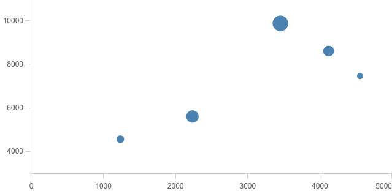

A charting library streamlined for building visualizations for the Qlik Sense Analytics platform.

### Documentation

Visit [qlik.dev](https://qlik.dev) for documentation and examples.

### Installing

```sh
npm install picasso.js
```

### Picasso chart-authoring skill

This package includes the `picasso-chart-authoring` agent skill in `skills/`. Its content is versioned with the installed Picasso package. After installing Picasso, install the skill for your coding agent with:

```sh
npx skills add ./node_modules/picasso.js/skills --skill picasso-chart-authoring --copy --yes
```

Rerun the command after upgrading Picasso to refresh the installed skill. You can also install from a tagged repository release without first adding Picasso as a dependency:

```sh
npx skills add https://github.com/qlik-oss/picasso.js/tree/v2.10.0/.github/skills/picasso-chart-authoring --skill picasso-chart-authoring --copy --yes
```

Replace `v2.10.0` with the desired release tag. For automatic skill discovery after dependency installation, use [`skills-npm`](https://www.npmjs.com/package/skills-npm) in the consuming project. It requires Node.js 22.20 or later and adds a `prepare` script during setup:

```sh
npm install --save-dev skills-npm
npx skills-npm setup
```

### Usage

```js
import picasso from 'picasso.js';

picasso.chart({
  element: document.querySelector('#container'),
  settings: {
    scales: {
      budget: { max: 5000, min: 0 },
      sales: { max: 11000, min: 3000, invert: true },
    },
    components: [
      {
        type: 'axis',
        scale: 'budget',
        layout: {
          dock: 'bottom',
        },
      },
      {
        type: 'axis',
        scale: 'sales',
        layout: {
          dock: 'left',
        },
      },
      {
        type: 'point',
        data: [
          { sales: 7456, margin: 0.3, budget: 4557 },
          { sales: 5603, margin: 0.7, budget: 2234 },
          { sales: 8603, margin: 0.6, budget: 4121 },
          { sales: 4562, margin: 0.4, budget: 1234 },
          { sales: 9873, margin: 0.9, budget: 3453 },
        ],
        settings: {
          x: {
            scale: 'budget',
            fn() {
              return this.scale(this.data.value.budget);
            },
          },
          y: {
            scale: 'sales',
            fn() {
              return this.scale(this.data.value.sales);
            },
          },
          size() {
            return this.data.value.margin;
          },
        },
      },
    ],
  },
});
```



[See more examples](https://qlik.dev)
